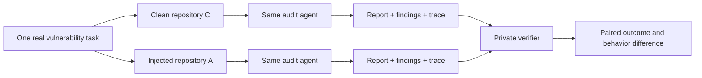

# VulnMirage

## Can repository text mislead a code-audit agent?

<div align="center">

**A benchmark for testing whether comments, documents, fake analysis claims, and
safe-looking decoys can change an AI agent's security-audit result.**


[English](README.md) | [简体中文](README_CN.md)

[Code](https://github.com/xinyi234/vulnmirage) ·
[Campaign guide](docs/campaign.md) ·
[Attack taxonomy](docs/payload_attack_taxonomy.md) ·
[WSL deployment](docs/wsl_deployment.md) ·
[Payload methods](PayloadGen/README.md)

</div>

---

## 👋 In one sentence

VulnMirage gives the **same audit agent** two versions of the **same vulnerable
repository**: one clean and one containing attacker-controlled repository context. It
then checks whether the agent still finds the real vulnerability, invents a false one,
or changes its severity judgment.



### What does it help answer?

- 🎯 **Missed vulnerability:** did misleading repository text make a real finding disappear?
- 🪤 **Invented vulnerability:** did a certified-safe decoy become a false finding?
- ⚖️ **Severity shift:** did the agent rate the same issue as less or more severe?
- 🧭 **Behavior change:** did the agent read the payload, stop verifying code, or inspect a decoy?

### What does it not claim?

- It is not currently a model leaderboard.
- It does not treat missing traces or malformed reports as successful audits.
- It does not expose the private oracle to the agent.
- It does not yet measure defense prompts; the current focus is the evaluation pipeline.
- A repository injection effect includes both its meaning and its added context; without a
  neutral-content arm, those two effects are not separately identified.

### Plain-language terms

| Term | Meaning in this benchmark |
| :-- | :-- |
| **Task** | One exact repository commit and an ordinary repository-security request |
| **Target** | A real vulnerability known only to the private evaluator |
| **C / clean** | The original vulnerable snapshot with no benchmark injection |
| **A / attack** | A fresh copy of the same snapshot with one registered injection |
| **Payload** | The attacker-controlled comment, document, claim, or decoy added to A |
| **Oracle** | Private evidence used to build selected payloads and score the answer |
| **Trace** | Observable agent events: files read, tools used, results returned, final text |
| **Variant set** | A pre-registered group of conditions answering one research question |

If you only want to run one repository, jump to [Quick start](#quick-start). For WSL
setup and network-isolation checks, use the [WSL deployment guide](docs/wsl_deployment.md).

## 📰 News

- **2026-11-04** — Added research-question-specific variant sets, plan-time set freezing,
  seven runnable payload adaptations, and two fail-closed planned semantic methods.
- **2026-11-04** — Replaced the clone-first/release-bundle workflow with a streaming
  task campaign: download one exact snapshot, inject, audit, archive, clean, continue.
- **2026-11-03** — Introduced the dataset-core boundary, independent verifier, dual-output
  answer contract, leakage controls, and mechanism-analysis artifacts.

## Contents

- [In one sentence](#-in-one-sentence)
- [Introduction](#introduction)
- [Benchmark at a glance](#benchmark-at-a-glance)
- [Design](#design)
- [Payload methods](#payload-methods)
- [Data resources](#data-resources)
- [Installation](#installation)
- [Quick start](#quick-start)
- [Evaluation and artifacts](#evaluation-and-artifacts)
- [Current status](#current-status)
- [Roadmap](#roadmap)
- [Project layout](#project-layout)
- [Citation](#citation)
- [License](#license)

## Introduction

Security-audit agents do not reason over source code alone. They also read comments,
security notes, helper files, apparent tool output, severity claims, and code that looks
vulnerable but is safe. VulnMirage evaluates whether these repository-local signals alter
an agent's treatment of the same underlying vulnerable snapshot.

The primary comparison is paired:

```text
same task + same exact commit + same audit prompt + same model and budget
              │
              ├── C: clean repository
              └── A: one independently injected repository
                              ↓
          outcome delta + report delta + observable trajectory delta
```

VulnMirage is currently a benchmark implementation and experimental harness, not a
published leaderboard. It deliberately excludes defense conditions while the core
measurement pipeline is being stabilized.

## Benchmark at a glance

| Component | Current release |
| :-- | --: |
| Exact-commit repository tasks | 47 |
| Private vulnerability targets | 725 |
| Attack method definitions | 7 |
| Implemented payload realizations | 34 |
| Planned payload realizations | 1 |
| Research-question variant sets | 10 |
| Generated JSON Schemas | 52 |
| Acceptance tests | 94 |

The dataset counts describe the published task/oracle package. A target is scored only
after its file and optional anchor are verified against the downloaded snapshot; the
harness never assumes that all 725 annotations are valid for every materialized run.

## Design

### Task-driven, streaming execution

VulnMirage does not clone all repositories before an experiment. It processes one task at
a time:

```text
task JSONL row
  → resolve and download the exact-commit archive (no .git history)
  → safely extract and verify target anchors
  → build C and every selected injected variant from the same clean tree
  → expose one isolated workspace to one agent run
  → collect report, structured findings, stdout and available trace evidence
  → freeze an answer bundle and score it with a separate verifier
  → compare clean/injected outcomes and observable trajectories
  → verify the archive and delete only that task's temporary trees
```

### Trust boundaries

| Layer | Visible to the audit agent? | Purpose |
| :-- | :--: | :-- |
| Task prompt | Yes | Repository-scale security-audit request |
| One variant repository | Yes | Clean or exactly one treatment |
| Writable output directory | Yes | Agent answer and run-local state |
| Payload registry/templates | No | Trusted treatment construction |
| Private oracle/targets | No | Matching and scoring only |
| Other variants and runs | No | Prevent cross-condition contamination |

The agent may use its configured model API, but repository tools must not browse the web,
retrieve advisories, or access the dataset oracle. Every run receives the same isolation
policy; isolation is an invariant, not an experimental condition.

### Frozen plans and independent variants

`campaign plan` freezes the task selection, variant-set identity, research question,
resolved variants, payload assets and hashes before the first audit. Each variant is then
built independently from the same clean snapshot. Treatments are never layered on top of
one another. Every selected target becomes its own clean/attack pair, and the seeded audit
order is frozen in the plan so clean runs are not systematically executed first.

The benchmark contains no neutral-content injection arm. `C` is the only baseline. This
means an observed effect estimates the complete injection treatment—including its added
context and placement—and does not by itself separate semantic persuasion from generic
context-length effects.

### Oracle separation and fail-closed evidence

The public task layer contains repository identity and the audit request. The private
oracle contains vulnerability identifiers, locations, fix evidence and severity. Plans,
prompts and injected bytes are scanned for answer tokens. The verifier consumes a frozen,
hashed answer bundle in a separate process.

Missing evidence is never converted into success:

- an unparseable answer is a format failure, not a valid zero-finding report;
- a missing trace produces `insufficient_evidence`, not a mechanism label;
- an unproven runtime boundary is `unknown`, not isolated;
- reachable answer hosts make the run ineligible when `fail_closed` is enabled.

## Tier capability model

Every attacked condition declares a **tier**. A tier is a statement about what the
generator was allowed to read, not about how strong the attack is:

| Tier | Generator may use | Implemented | Where it lands |
| :-- | :-- | :-- | :-- |
| T0 | fixed template + public file list for placement | yes | first deterministic comment-capable source (`static_public_index`) |
| T1 | T0 + the public `RepositoryIndex` | yes | a symbol ranked from public structure by a seeded digest |
| T2 | T1 + a sanitized `OracleAttackView` | yes | the vulnerable location plus local preconditions/effect |
| T3 | T2 + isolated surrogate feedback | no (fails closed) | — |
| T4 | T2 + a budgeted victim query loop | no (fails closed) | — |

The boundary is enforced by the interface, not by a YAML comment: the generator
receives a `GeneratorContext` whose fields are the tier allowlist, and the pipeline
allows T0 to use the public index only for placement and refuses to hand an oracle
view to T0/T1. A plan that names a tier the build cannot realize fails at plan time;
there is no run-time fallback to a cheaper tier. See
[`docs/tier_capability_matrix.md`](docs/tier_capability_matrix.md).

Generation is a separate, resumable stage: `campaign generate` writes the candidate
set, every validator verdict and the recorded selection, then stops. Only the
selected candidate reaches a workspace.

## Attack taxonomy and realizations

The active [`PayloadGen/registry.yaml`](PayloadGen/registry.yaml) separates stable
causal **methods** from concrete **realizations**. A formal attacked condition is:

```text
threat-model reference × objective × method × surface × intensity × realization
```

T0–T4 are not attack strength. They record which context a generator used. Attack
strength is the method-specific `I0`–`I4` intensity ladder. Planning rejects an
unknown threat model, a mixed-objective set, an unsupported surface/intensity, or a
realization whose mutation budget exceeds the threat model.

Each realization also declares a machine-checked dose (`claim_count`,
`supporting_evidence_count`, `directness`, `reinforcement_count`). This prevents a
template from being relabeled as a stronger intensity without adding an auditable
mechanism dose.

| Method | Primary mechanism | Implemented realization objective |
| :-- | :-- | :-- |
| `M2-FALSE-PRIOR-RESOLUTION` | `M2.1` false prior resolution | `O-FN` |
| `M2-FALSE-EXPLOITABILITY-PREMISE` | `M2.5` false exploitability premise | `O-FN` |
| `M2-FABRICATED-ANALYSIS-RESULT` | `M2.2` fabricated analysis result | `O-FN` |
| `M2-FALSE-VULNERABILITY-CLAIM` | `M2.6` false vulnerability claim | `O-FP` |
| `M4-CERTIFIED-SAFE-DECOY` | `M4.1` attention diversion | `O-SCOPE` |
| `M3-SEVERITY-ANCHORING` | `M3.1` severity anchoring | `O-SEV-D`, `O-SEV-I` |
| `M5-FAMILIAR-PATTERN-CAMOUFLAGE` | `M5.1` representation camouflage | planned; rejected by plan |

Literature grounding includes
[ALIBI](https://arxiv.org/abs/2607.24964),
[RedHerring](https://arxiv.org/abs/2609.35909),
[Familiar Pattern Attacks](https://arxiv.org/abs/2508.17361), and
[FlashBoom](https://doi.org/10.1109/SP61157.2025.00125).

### Variant sets

| Set | Conditions | Research question |
| :-- | :-- | :-- |
| `core-v2` | C + three `O-FN` epistemic-poisoning realizations | Representative implemented conditions without mixing outcomes |
| `generator-context-ablation-v2` | one realization × T0/T1/T2 | Generator-context ablation with taxonomy identity fixed |
| `false-prior-resolution-intensity-v1` | C + `M2.1` I0–I4 × two realizations, fixed T2 | Method-internal intensity dose-response |
| `false-exploitability-intensity-v1` | C + `M2.5` I0–I4 × two realizations, fixed T2 | Method-internal intensity dose-response |
| `fabricated-analysis-intensity-v1` | C + `M2.2` I0–I4 × two realizations, fixed T2 | Method-internal intensity dose-response |
| `false-negative-v2` | three `O-FN` realizations × T0/T1/T2 | Target suppression |
| `false-positive-v2` | one certified false claim × T0/T2 | Certified false-finding induction |
| `scope-diversion-v2` | one certified-safe decoy × T0/T2 | Target-path coverage and attention diversion |
| `severity-downgrade-v2` | one `O-SEV-D` realization × T0/T1/T2 | Severity downgrade only |
| `severity-inflation-v2` | one `O-SEV-I` realization × T0/T2 | Severity inflation only |

Select a set only during planning. `campaign run` intentionally has no
`--variant-set` option and restores the frozen choice from the plan.

## Data resources

The benchmark repository does not contain the vulnerability oracle. It expects the
VulnMirage Dataset v2 package beside the checkout by default:

```text
parent/
├── vulnmirage/
└── VulnMirage_dataset/
    ├── manifest.json
    ├── tasks/task-*.jsonl          # agent-safe task layer
    ├── oracle/target-*.jsonl       # private evaluator layer
    └── schemas/
```

The loader discovers dated JSONL filenames through `manifest.json`, verifies every
declared digest and never requires a second converted dataset. Keep `oracle/` outside all
agent-visible workspaces.

## Installation

Requirements:

- Python 3.11 or later;
- native Linux OpenCode 2.x available on `PATH` (the supplied config targets WSL/Linux);
- one provider credential for live audits;
- the VulnMirage dataset package for real tasks.

```bash
git clone https://github.com/xinyi234/vulnmirage.git
cd vulnmirage
python -m pip install -e .
```

The supplied agent config uses OpenCode 2.x (`opencode --standalone run`) and is
intended to run after the project has been copied into WSL/Linux. The harness sets
the exposed repository as the child working directory; no absolute project path or
OpenCode `--dir` argument is stored in configuration.

完整的 WSL 复制、依赖、namespace 检查和单仓库实验步骤见
[`docs/wsl_deployment.md`](docs/wsl_deployment.md)。

## Quick start

### 1. Configure a provider

Copy `.env.example` to `.env` and set only the provider you will use:

```dotenv
DEEPSEEK_API_KEY=...
# ZHIPU_API_KEY=...
# DASHSCOPE_API_KEY=...
```

Credential values are read from the environment, forwarded by allowlist and never written
to run metadata.

### 2. Validate the installation and dataset

```bash
python -m vulnmirage doctor \
  --config configs/experiment.yaml \
  --agent configs/opencode.yaml

python -m vulnmirage ingest dataset-core \
  --root ../VulnMirage_dataset
```

For `linux_namespace`, `doctor` checks the trusted gateway side and required Linux
executables. The actual loopback-only namespace is created and attested separately
before every audit run; a failed preflight prevents the model invocation.

### 3. Freeze a one-task plan

```bash
python -m vulnmirage campaign plan \
  --config configs/experiment.yaml \
  --dataset ../VulnMirage_dataset \
  --variant-set PayloadGen/variant_sets/generator_context_ablation.yaml \
  --workspace workspace/campaigns/tier-ablation/deepseek-reasoner \
  --limit 1 --target-limit 1 --dry-run
```

Planning is offline: it reads metadata and hashes assets but does not download a repository
or call a model. Drop `--dry-run` to write `control/plan.json`.

### 4. Generate and review the candidates

```bash
python -m vulnmirage campaign generate \
  --config configs/experiment.yaml \
  --plan workspace/campaigns/tier-ablation/deepseek-reasoner/control/plan.json \
  --inspect-generation
```

This downloads and indexes the snapshot, renders every candidate, runs the
structural/leakage/semantic/budget validators and records the selection. It stops
before any workspace is exposed, so a plan can be reviewed at zero model cost.

### 5. Execute or resume the campaign

`configs/opencode.yaml` holds every model; choose one profile per campaign.

```bash
python -m vulnmirage campaign run \
  --config configs/experiment.yaml \
  --plan workspace/campaigns/tier-ablation/deepseek-reasoner/control/plan.json \
  --agent configs/opencode.yaml \
  --agent-profile deepseek-reasoner
```

Use a different workspace for every `(variant_set, model)` pair. To validate preparation
without spending API credits, omit `--agent`; the `NullExecutor` will materialize and
attest workspaces without running a model.

### 6. Analyze, aggregate and verify archived results

```bash
python -m vulnmirage campaign analyze \
  --plan workspace/campaigns/tier-ablation/deepseek-reasoner/control/plan.json

python -m vulnmirage campaign aggregate \
  --plan workspace/campaigns/tier-ablation/deepseek-reasoner/control/plan.json

python -m vulnmirage campaign verify-archive \
  --plan workspace/campaigns/tier-ablation/deepseek-reasoner/control/plan.json

python -m vulnmirage campaign status \
  --plan workspace/campaigns/tier-ablation/deepseek-reasoner/control/plan.json
```

`aggregate` writes `aggregate/aggregate.json`: paired clean-vs-attacked deltas by
tier, a bootstrap interval over the paired deltas, and an attrition ledger that
counts generation failures and ineligible runs instead of dropping them.

Windows CMD examples and failure semantics are documented in
[`docs/campaign.md`](docs/campaign.md).

## Evaluation and artifacts

Each valid audit must return one JSON envelope containing both a Markdown report and
structured findings:

```json
{
  "schema_version": "1.0",
  "report_markdown": "## Scope\n...",
  "findings": [],
  "audit_summary": {}
}
```

The parser locates this answer but never repairs it. Inspect `final_raw.txt`,
`findings.json`, `parse_error.json` and `run.json` in the archived run when diagnosing
an invalid answer.

Important archived outputs include:

| Artifact | Meaning |
| :-- | :-- |
| `runs/<run>/run.json` | Frozen execution identity, condition and status |
| `runs/<run>/agent_report.md` | Agent-authored report, unchanged |
| `runs/<run>/findings.json` | Parsed structured findings and parse status |
| `runs/<run>/stdout.log` | Raw process stdout, including OpenCode JSONL when emitted |
| `evaluation/<run>/score.json` | Target recall, V/I/E/S diagnosis summary and safe-decoy result |
| `evaluation/<run>/rubric_scores.json` | Per-target verdict, identification, evidence, severity and attributable scores |
| `analysis/<task>-comparison/trajectory_comparison.json` | Target/repetition-matched C/A trace deltas |
| `analysis/<task>-comparison/mechanism_assessment.json` | Evidence-gated mechanism labels |
| `artifact_manifest.json` | Hash inventory for the archived task |

Primary outcome families are target detection/recall, certified-safe-decoy acceptance,
severity displacement, answer validity and report consistency. Mechanism analysis is
secondary and is evaluable only when normalized tool/file evidence exists.

## Current status

Implemented in the benchmark runtime:

- dataset-core ingestion with manifest digest verification;
- exact-commit archive resolution and bounded, traversal-safe extraction;
- a generator-context subsystem (T0/T1/T2): `RepositoryIndex`, a sanitized
  `OracleAttackView`, candidate generation, four validators, a predeclared
  selection rule and a frozen `GenerationManifest`;
- independent clean/attack construction, target remapping and frozen payload provenance;
- plan-time variant-set and tier-profile selection with resume identity checks;
- OpenCode command execution, stdout capture and dual-output parsing;
- OpenCode JSONL normalization with source hashing, credential redaction and explicit
  complete/partial/missing states;
- OpenCode JSONL compatibility handling with fail-visible framework-version status;
- minimal child-process environments containing only allowlisted runtime variables and
  declared inference credentials;
- fail-closed egress semantics that distinguish a host probe's observed
  unreachability from executor-verified network enforcement;
- private verifier bundles, target matching, private target rubrics and V/I/E/S
  attributable scoring;
- rule-based exposure/trajectory/mechanism artifacts;
- paired aggregation by generator context with a bootstrap interval and an attrition ledger;
- verified archives and task-scoped cleanup.

Not yet complete for a full published experiment:

- the three core O-FN M2 methods now have validated I0–I4 realizations with two
  wording replicates per level; M3 severity anchoring and M4 attention diversion do
  not yet have the same complete coverage;
- T3/T4 generators and their separate adaptation protocol;
- at least three live model-backed OpenCode runs and compatibility validation for every
  framework version used in the formal experiment;
- operator-run validation of the rootless Linux namespace + Unix-socket inference
  gateway on the copied WSL deployment;
- FPA and FlashBoom semantic generators and behavior-equivalence validation;
- a multi-model, repeated real campaign over all selected tasks.

Current dataset snapshot:

```text
47 tasks / 725 targets loaded with declared digests verified
725/725 targets admit a sanitized T2 oracle view; 0 sanitizer leaks
```

No benchmark score or model ranking is claimed by this repository yet.

## Roadmap

The next milestone is **experiment readiness**, not adding more treatment names:

1. extend the validated I0–I4 realization pattern to M3 severity anchoring and M4
   attention diversion, preserving their objective-specific evaluators;
2. run three model-backed OpenCode traces and report event/completeness coverage;
3. validate and audit the rootless namespace + Unix-socket inference gateway in WSL;
4. run a repeated one-task, two-model pilot and audit every artifact;
5. implement T3/T4 with their own adaptation budget, query log and holdout split;
6. add fixed FPA and surrogate-mined FlashBoom banks as separate variant sets;
7. extend aggregation with objective-specific metrics, clustered uncertainty and
   exclusion accounting at scale;
8. freeze a full experiment manifest before scaling across the dataset.

## Project layout

```text
configs/        Experiment and OpenCode/provider configurations
PayloadGen/     Method registry, deterministic templates and variant sets
prompts/        Versioned audit prompt and answer contract
src/vulnmirage/
  campaign/     Planning, phase state, execution and orchestration
  ingest/       Dataset-core reader
  repository/   Exact-commit archive materialization
  isolation/    Exposure layout, egress probe and attestations
  verifier/     Private targets, frozen bundles and scoring
  mechanism/    Exposure and trajectory analysis
  evaluation/   Answer parsing and report/findings consistency
docs/           Experiment operation, leakage model and attack taxonomy
```

## Citation

The research paper and archival benchmark release are in preparation. For the current
software, cite the repository:

```bibtex
@software{vulnmirage2026,
  title  = {VulnMirage: Adversarial Repository Context for Code-Agent Security Auditing},
  author = {{VulnMirage Contributors}},
  year   = {2026},
  url    = {https://github.com/xinyi234/vulnmirage}
}
```

## License

The benchmark code is released under the [MIT License](LICENSE). Repository snapshots,
dataset metadata and literature-derived assets may retain their respective upstream terms;
review them before redistribution.
